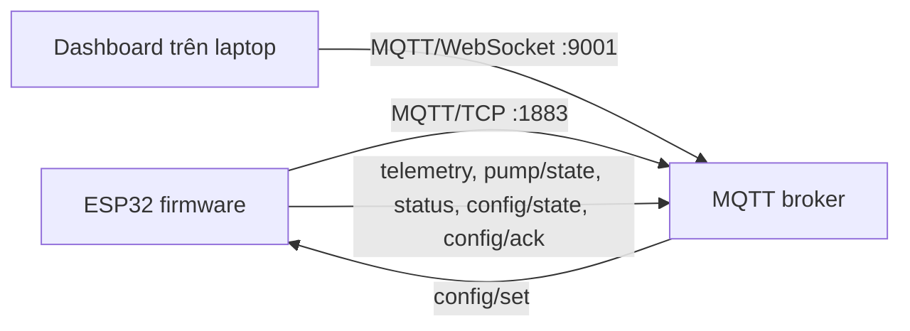

# MQTT giữa ESP32 và dashboard

Sơ đồ module firmware và vị trí đặt breakpoint: [STRUCTURE.md](STRUCTURE.md).

## 1. Luồng dữ liệu



Firmware hiện tại vẫn là **một ESP32** đọc DHT22, đọc độ ẩm đất và điều khiển
bơm. MQTT được thêm vào firmware này. Khi tách thành ESP32 A/B theo sơ đồ BTL,
giữ nguyên hợp đồng topic bên dưới; A có thể phát telemetry, còn B phát
`pump/state` và nhận `config/set`. Việc chuyển dữ liệu giữa A và B qua ESP-NOW
thuộc phần việc riêng.

ESP32 dùng MQTT qua TCP. Trình duyệt không kết nối cổng TCP 1883 trực tiếp;
dashboard dùng MQTT qua WebSocket. Cả hai phải nối **cùng một broker**.

## 2. Cấu hình broker và mạng

1. Tạo broker có listener TCP và WebSocket. Ví dụ Mosquitto trên mạng LAN:

   ```conf
   listener 1883 0.0.0.0
   protocol mqtt

   listener 9001 0.0.0.0
   protocol websockets

   allow_anonymous false
   password_file /duong/dan/toi/passwords
   ```

   Tạo tài khoản bằng `mosquitto_passwd -c /duong/dan/toi/passwords watering`.
   Đổi đường dẫn theo máy chạy broker. Mở firewall cho cổng 1883 và 9001 trên
   mạng LAN. Broker cần bản build có hỗ trợ WebSocket.

2. Sao chép `include/MqttSettings.example.h` thành `include/MqttSettings.h`.
   Điền SSID, mật khẩu Wi-Fi, IP/tên miền broker, cổng TCP, user/password broker
   và `kDeviceId`. File riêng này đã được `.gitignore` bỏ qua. Nếu chưa điền
   SSID/host, firmware vẫn chạy BLE nhưng MQTT tạm tắt.

   ```cpp
   namespace MqttSettings {
   constexpr char kWifiSsid[] = "TenWiFi";
   constexpr char kWifiPassword[] = "MatKhauWiFi";
   constexpr char kBrokerHost[] = "192.168.1.20";
   constexpr unsigned short kBrokerPort = 1883;
   constexpr char kBrokerUser[] = "watering";
   constexpr char kBrokerPassword[] = "MatKhauBroker";
   constexpr char kDeviceId[] = "esp32-01";
   }
   ```

3. Build và nạp: `pio run -e esp32dev` rồi `pio run -e esp32dev -t upload`.
   `platformio.ini` dùng partition `min_spiffs.csv` vì firmware BLE + Wi-Fi +
   MQTT lớn hơn phân vùng app mặc định. Board cần 4 MB flash.

4. Chạy dashboard qua HTTP cục bộ: `python -m http.server 8000` ở thư mục repo,
   rồi mở `http://localhost:8000`. Nhập `ws://192.168.1.20:9001`, cùng
   `deviceId` như firmware và tài khoản broker; bấm **Kết nối MQTT**.
   Dashboard dùng bản MQTT.js 5.14.1 đã lưu tại `vendor/mqtt.min.js`, nên trang
   không cần CDN. Mật khẩu broker chỉ giữ trong phiên trang, không lưu localStorage.

5. Nếu dashboard được phục vụ qua HTTPS, broker phải có endpoint `wss://`.
   Browser sẽ không chấp nhận `ws://` từ trang HTTPS. Bản firmware này dùng
   MQTT TCP thường; triển khai broker ra Internet cần bổ sung TLS trên ESP32
   trước khi dùng ngoài LAN tin cậy.

## 3. Quy ước topic và payload

`<id>` là `kDeviceId`, ví dụ `esp32-01`. Prefix là `watering/<id>`.

| Topic | Hướng | Retain | Nội dung |
| --- | --- | --- | --- |
| `watering/<id>/status` | ESP32 → dashboard | Có | `online` hoặc Last Will `offline` |
| `watering/<id>/telemetry` | ESP32 → dashboard | Có | JSON kết quả chu kỳ đọc cảm biến |
| `watering/<id>/pump/state` | ESP32 → dashboard | Có | JSON trạng thái chân bơm, số lần tưới |
| `watering/<id>/config/state` | ESP32 → dashboard | Có | JSON 9 hàm membership và 27 luật |
| `watering/<id>/config/set` | dashboard → ESP32 | **Không** | JSON action `get`, `set`, `reset` |
| `watering/<id>/config/ack` | ESP32 → dashboard | Không | JSON ACK cùng `requestId` |

Telemetry hợp lệ, phát sau mỗi chu kỳ đo (mặc định 10 giây):

```json
{"v":1,"uptimeMs":30123,"valid":true,"temperatureC":28.4,"airHumidityPct":63.1,"soilMoisturePct":37.2,"soilRaw":2205,"pumpCommandMs":750,"noWaterFailCount":0,"noWaterAlert":false}
```

`pumpCommandMs` là **lệnh** của chu kỳ, không khẳng định bơm đang bật. Trạng thái
thật ở `pump/state`:

```json
{"v":1,"uptimeMs":30135,"pumpOn":true,"wateringCount":3}
```

`wateringCount` tăng sau khi một xung bơm kết thúc và hiện đếm từ lần boot
gần nhất. `uptimeMs` là thời gian từ lúc ESP32 boot, không phải giờ thực tế.

Khi cảm biến hoặc luật mờ lỗi, firmware ngừng ra lệnh bơm và phát:

```json
{"v":1,"uptimeMs":40123,"valid":false,"error":"soil"}
```

`error` có thể là `soil`, `dht`, `fuzzy` hoặc `config_busy`. Dashboard không
hiển thị các giá trị đo cũ như giá trị mới khi `valid=false`.

Lấy cấu hình hiện tại:

```json
{"requestId":"get-001","action":"get"}
```

Đặt toàn bộ cấu hình trong **một** bản tin để tránh chỉ cập nhật một phần:

```json
{
  "requestId":"set-001",
  "action":"set",
  "config":{
    "mf":{
      "sl":[-1,0,30],"sm":[25,32,40],"sh":[35,100,101],
      "hl":[-1,0,60],"hm":[40,60,80],"hh":[60,100,101],
      "th":[30,50,51],"tm":[15,25,30],"tc":[-1,0,20]
    },
    "rl":[[2,2,1],[2,1,1],[1,1,1]],
    "rm":[[2,1,1],[1,1,0],[1,0,0]],
    "rh":[[0,0,0],[0,0,0],[0,0,0]]
  }
}
```

Reset toàn bộ về mặc định: `{"requestId":"reset-001","action":"reset"}`.
ESP32 kiểm tra đủ 9 bộ ba, `a ≤ b ≤ c`, 27 luật chỉ nhận `0/1/2`, rồi mới
lưu NVS một lần. Nếu sai, cấu hình cũ được giữ. Phản hồi:

```json
{"v":1,"requestId":"set-001","ok":true,"reason":"ok"}
```

Các `reason` lỗi: `invalid_json`, `invalid_request_id`, `payload_too_large`, `invalid_config`,
`config_busy`, `publish_failed`, `unknown_action`.

## 4. Kết nối lại và giới hạn hiện tại

- Firmware thử lại Wi-Fi mỗi 10 giây và MQTT mỗi 5 giây; dashboard tự reconnect
  mỗi 3 giây. `status` dùng Last Will retained để báo offline khi ESP32 mất kết nối.
- Sau reconnect, ESP32 phát lại **snapshot mới nhất** của telemetry và bơm.
  Các bản tin đo trong thời gian mất mạng chưa được lưu lịch sử. Hàng đợi
  LittleFS/gửi bù là task riêng trong tài liệu BTL.
- PubSubClient phát telemetry/trạng thái với QoS 0. Dashboard gửi config với
  QoS 1 và đợi ACK ứng dụng tối đa 10 giây; `set`/`reset` là thao tác có thể
  gửi lại nếu mất ACK. Không đặt retain cho `config/set`.
- Cấu hình từ BLE và MQTT đều dùng chung NVS. Firmware không còn xóa NVS khi
  boot; cấu hình đã lưu sẽ tồn tại sau khi khởi động lại.

## 5. Kiểm tra nhanh

Sau khi ESP32 nối broker, dùng máy có Mosquitto CLI:

```sh
mosquitto_sub -h 192.168.1.20 -p 1883 -u watering -P 'MatKhauBroker' -t 'watering/esp32-01/#' -v
```

Kỳ vọng: `status online`, `config/state`, `pump/state`, rồi `telemetry` khoảng
10 giây một lần. Mở dashboard và kiểm tra cùng số đo. Bấm gửi luật, theo dõi
`config/ack` và `config/state`; khởi động lại ESP32 và kiểm tra luật còn giữ.
Ngắt Wi-Fi ESP32, đợi broker chuyển `status offline`, nối lại và xác nhận
dashboard nhận snapshot mới.

Không có broker và phần cứng trong repo nên các bước trên phải chạy tại bộ
thiết bị của bạn; build firmware chỉ kiểm tra biên dịch.

Tài liệu tham khảo: [PubSubClient](https://github.com/knolleary/pubsubclient),
[MQTT.js](https://github.com/mqttjs/MQTT.js),
[Mosquitto configuration](https://mosquitto.org/man/mosquitto-conf-5.html).
