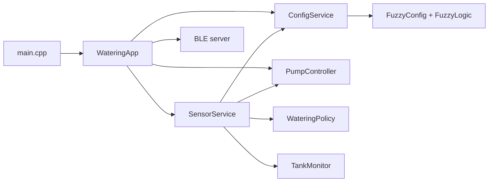

# Cấu trúc firmware và cách debug

`src/main.cpp` chỉ tạo `WateringApp` và gọi `begin()`/`tick()` từ entry point
Arduino. Mỗi module bên dưới sở hữu trạng thái của chính nó; BLE nhận dữ liệu
qua queue, không đọc trực tiếp biến trong sensor task.

| Module | Trách nhiệm | Điểm bắt đầu khi debug |
| --- | --- | --- |
| `AppConfig.h` | Chân GPIO, chu kỳ đọc, ngưỡng tưới/cảnh báo | Kiểm tra cấu hình phần cứng và ngưỡng |
| `SensorService.cpp` | Đọc DHT22/đất, lọc EMA, gọi luật mờ, tạo telemetry | `run()` và `publishInvalid()` |
| `WateringPolicy.h` | Xác nhận hai chu kỳ, ngưỡng bật/tắt bơm | `update()` |
| `TankMonitor.cpp` | So sánh độ ẩm trước/sau khi bơm để cảnh báo | `update()` |
| `PumpController.cpp` | Queue lệnh, GPIO4, đếm số lần tưới, báo trạng thái bơm | `run()` |
| `ConfigService.cpp` | Mutex, đọc/ghi luật mờ, suy luận trên snapshot cấu hình | `calculateWaterPercent()`, `applyCommand()` |
| `FuzzyConfig.h` | Dữ liệu luật mờ, JSON và NVS | `applyCommand()`, `saveToNVS()` |
| `FuzzyLogic.h` | Hàm suy luận thuần với `FuzzyParams` truyền vào | `fuzzy_defuzzify()` |
| `BLE_server.cpp` | BLE characteristic và lệnh BLE cũ | `ConfigCallbacks::onWrite()` |
| `WateringApp.cpp` | Thứ tự khởi tạo, chuyển queue sang BLE, nhắc cảnh báo | `begin()`, `tick()` |

## Luồng một chu kỳ đo

1. `SensorService` đọc DHT22 và cảm biến đất. Lỗi đo làm `publishInvalid()`
   gửi lệnh bơm 0 ms và telemetry `valid=false`.
2. Với dữ liệu hợp lệ, service làm mượt độ ẩm đất, gọi `ConfigService` tính
   mức tưới, rồi dùng `WateringPolicy` xác nhận thời gian bơm.
3. `TankMonitor` chỉ đánh giá khả năng hết nước nếu `PumpController` báo lần
   bơm trước đã chạy thật. Sensor service gửi lệnh bơm và snapshot vào queue.
4. `PumpController` bật/tắt GPIO4 trong task riêng, đẩy trạng thái bơm vào queue.
5. `WateringApp::tick()` lấy các snapshot, phát BLE và theo dõi cảnh báo.

## Khi gặp lỗi

- **Không có số đo:** xem log `[DHT22]`/`[Sensor]`, kiểm tra
  `SensorService::publishInvalid()` và giá trị `soilRaw`.
- **Có số đo nhưng không tưới:** xem `WateringPolicy::update()`, ngưỡng trong
  `AppConfig.h`, rồi log `[Pump]`.
- **Bơm chạy nhưng báo hết nước:** xem `PumpController::takeLastRunMs()` và
  `TankMonitor::update()`; cảm biến đất cần hiệu chuẩn riêng trên phần cứng.
- **Luật tưới không đổi:** xem lệnh BLE ở `ConfigCallbacks::onWrite()`, sau đó
  `ConfigService::applyCommand()` và `FuzzyConfig::saveToNVS()`.

Các dòng log có tiền tố `[Sensor]`, `[Pump]`, `[Tank]`, `[BLE]`,
`[Config]`, `[App]` để lọc nhanh trong Serial Monitor 9600 baud.
